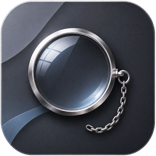

<p align="center">
  
</p>

<h1 align="center">PovarDock</h1>

<p align="center">Ein anpassbares Dock mit Tastatur-Launcher für Windows 11.</p>

<p align="center">
  <a href="README.md">English</a> · <a href="README.ru.md">Русский</a> · <strong>Deutsch</strong>
</p>

<p align="center">
  <a href="https://github.com/povargg/PovarDock/releases/latest"></a>
  <a href="LICENSE"></a>
  
</p>

<p align="center">
  <a href="https://github.com/povargg/PovarDock/releases/latest/download/povardock-x64.exe"><strong>Für Windows x64 herunterladen</strong></a>
  ·
  <a href="https://github.com/povargg/PovarDock/releases">Versionshinweise</a>
</p>

## Was du mit PovarDock machen kannst

Finde Apps, Dateien und Emojis per Tastatur und wechsle mit Tastenkürzeln
zwischen virtuellen Desktops. Hefte die Apps an, die du oft brauchst, und passe
das Dock mit einem Farbschema oder Liquid Glass an.

| Funktion | Was du damit machen kannst |
| --- | --- |
| **Launcher** | Mit <kbd>Alt</kbd>+<kbd>Leertaste</kbd> öffnest du den Launcher für Apps, Dateien, Fenster und Emojis. Dort kannst du auch Befehle ausführen, rechnen und im Web suchen. |
| **Dock und Infobereich** | Hefte Apps an, ändere ihre Reihenfolge, wechsle zwischen Fenstern und öffne Sprunglisten. Du kannst die Bereiche im Dock anordnen, einen Bildschirm auswählen und das Dock dauerhaft anzeigen oder automatisch ausblenden. |
| **Systemfunktionen** | Im Dock findest du Uhr, Lautstärke, Mediensteuerung, Akkustand, WLAN und Bluetooth. Über das Energiemenü kannst du den PC in den Energiesparmodus versetzen, ihn neu starten oder herunterfahren. |
| **Designs** | Zur Auswahl stehen unter anderem Gruvbox, Tokyo Night, Nord, Catppuccin und Rosé Pine. Passe Farbe und Hintergrund an oder probiere Liquid Glass aus und stelle Rand, Lichtbrechung und Transparenz ein. |
| **Virtuelle Desktops** | Wechsle mit den Pfeilen neben der Nummer oder mit **Alt + 1–9** zwischen den Desktops. Beim Wechsel per Tastenkürzel werden fehlende Desktops bis zur gewählten Nummer erstellt. Auf dem letzten Desktop legt der rechte Pfeil einen weiteren an. Die Modifikatortasten lassen sich unter **Settings → General** ändern. |
| **Portable Anwendung** | Dock, Launcher und Einstellungen stecken in derselben ausführbaren Datei. Unter **Settings → About** kannst du nach neuen Versionen von PovarDock suchen. |

> [!NOTE]
> Liquid Glass befindet sich in einer frühen Entwicklungsphase. Auf manchen
> Hintergründen können Lichtbrechung und Ränder noch ungleichmäßig aussehen.
> Bei einem Wert von **0 %** für **Transparency** ist die Oberfläche nahezu
> undurchsichtig.

## Installation

1. Laden Sie `povardock-x64.exe` von der [Seite der aktuellen Version](https://github.com/povargg/PovarDock/releases/latest) herunter.
2. Verschieben Sie die Datei in einen Ordner mit Schreibzugriff, etwa `%LOCALAPPDATA%\Programs\PovarDock`, und führen Sie sie aus.
3. Legen Sie unter **Settings** das Tastenkürzel für den Launcher fest und wählen Sie, ob die Anwendung mit Windows gestartet werden soll. Standardmäßig öffnet <kbd>Alt</kbd>+<kbd>Leertaste</kbd> den Launcher.

Zum Ersetzen einer älteren portablen Version beenden Sie PovarDock über das Symbol
im Infobereich und ersetzen Sie die ausführbare Datei im selben Ordner. Weitere
Updates stehen unter **About** zur Verfügung. Die Datei `SHA256SUMS.txt` ist
dem Release zur Überprüfung des Downloads beigefügt.

## Aus dem Quellcode kompilieren

Für den Build werden Windows x64, die in `rust-toolchain.toml` angegebene
Rust-Toolchain, die Visual Studio C++ Build Tools für MSVC und der
Shader-Compiler `fxc.exe` aus dem Windows SDK benötigt. Falls das Verzeichnis
des Compilers nicht in `PATH` enthalten ist, setzen Sie `GPUI_FXC_PATH` auf
den Pfad zu `fxc.exe`.

```powershell
cargo build --locked --release -p wisp --bin wisp
.\scripts\package-release.ps1 -Executable .\target\release\wisp.exe -OutputDirectory .\dist
cargo test --workspace --locked
```

Beim Paketieren werden `dist\povardock-x64.exe` und `dist\SHA256SUMS.txt` erstellt.

Der Release-Workflow wird durch Tags für stabile Versionen ausgelöst. Passen Sie
die Version in beiden Cargo-Manifesten an, aktualisieren Sie `Cargo.lock` und
verwenden Sie einen passenden Tag wie `v0.9.1`.

## Herkunft und Lizenz

PovarDock basiert auf [Wisp](https://github.com/SumirSeth/wisp) von Sumir Seth
und weiteren Mitwirkenden. Der ursprüngliche Urheberrechtshinweis und die
[MIT-Lizenz](LICENSE) liegen dem Quellcode bei.

PovarDock enthält außerdem Emoji-Daten aus Gemoji und Unicode CLDR sowie Symbole
von Lucide. [Hinweis zu Gemoji](assets/LICENSE-GEMOJI) · [Hinweis zu Unicode](assets/LICENSE-CLDR) · [Hinweis zu Lucide](settings/assets/icons/LICENSE-LUCIDE).
