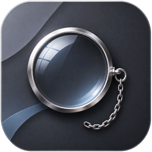

<p align="center">
  
</p>

<h1 align="center">PovarDock</h1>

<p align="center">An independently developed dock and keyboard launcher for Windows 11.</p>

<p align="center">
  <a href="https://github.com/povargg/PovarDock/releases/latest"></a>
  <a href="LICENSE"></a>
  
</p>

<p align="center">
  <a href="https://github.com/povargg/PovarDock/releases/latest/download/povardock-x64.exe"><strong>Download for Windows x64</strong></a>
  ·
  <a href="https://github.com/povargg/PovarDock/releases">Release notes</a>
</p>

I build and release PovarDock independently. Its roadmap follows my own ideas
for navigating virtual desktops, launching apps from the keyboard, and making
the dock fit the rest of the desktop.

## What you can do

| Feature | What it gives you |
| --- | --- |
| **Keyboard launcher** | Press <kbd>Alt</kbd>+<kbd>Space</kbd> to find apps, files, windows, and emoji. The launcher also runs commands and handles calculations and web searches. |
| **Dock and tray** | Pin and reorder apps, switch between windows, open Jump Lists, and arrange the dock's sections. Choose a display and keep the dock visible or let it hide. |
| **System controls** | Reach the clock, volume, media, battery, Wi-Fi, and Bluetooth from the dock. The power menu gives you quick access to sleep, restart, and shutdown. |
| **Themes** | Use palettes such as Gruvbox, Tokyo Night, Nord, Catppuccin, and Rosé Pine. Adjust color and backdrop, or try Liquid Glass and tune its rim, refraction, and transparency. |
| **Virtual desktops** | Use the arrows beside the desktop number or press **Alt + 1–9** to select a desktop. A shortcut creates any missing desktops up to its number. The right arrow creates the next desktop at the end of the row. Change modifiers in **Settings → General**. |
| **Portable app** | The dock, launcher, and Settings live in the same executable. Check for new PovarDock builds under **Settings → About**. |

> [!NOTE]
> Liquid Glass is in early development. Its refraction and edges can still look rough on some backgrounds. Set **Transparency** to **0%** for an almost opaque surface.

## Install

1. Download `povardock-x64.exe` from the [latest release](https://github.com/povargg/PovarDock/releases/latest).
2. Move the file to a folder you can write to, such as `%LOCALAPPDATA%\Programs\PovarDock`, and run it.
3. Choose a launcher shortcut and whether to start the app with Windows in **Settings**. The default launcher shortcut is <kbd>Alt</kbd>+<kbd>Space</kbd>.

To replace an older portable build, exit PovarDock from its notification-area icon
and replace the executable in the same folder. Future updates are available on
the **About** page. The release includes `SHA256SUMS.txt` for checking the download.

## Build from source

Use Windows x64, the Rust toolchain in `rust-toolchain.toml`, Visual Studio C++
Build Tools for the MSVC toolchain, and the Windows SDK's `fxc.exe` shader
compiler. Set `GPUI_FXC_PATH` to the compiler path if it is outside your `PATH`.

```powershell
cargo build --locked --release -p wisp --bin wisp
.\scripts\package-release.ps1 -Executable .\target\release\wisp.exe -OutputDirectory .\dist
cargo test --workspace --locked
```

The package step creates `dist\povardock-x64.exe` and `dist\SHA256SUMS.txt`.

The release workflow runs on stable version tags. Bump the version in both Cargo
manifests, update `Cargo.lock`, and use a matching tag such as `v0.9.1`.

## Origin and license

The starting point for PovarDock was [Wisp](https://github.com/SumirSeth/wisp),
created by Sumir Seth and its contributors. The original copyright notice and
[MIT license](LICENSE) are included with the source.

PovarDock also includes emoji data from Gemoji and Unicode CLDR, and icons from
Lucide. [Gemoji notice](assets/LICENSE-GEMOJI) · [Unicode notice](assets/LICENSE-CLDR) · [Lucide notice](settings/assets/icons/LICENSE-LUCIDE).
