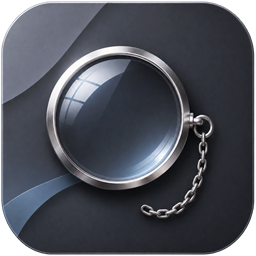

<p align="center">
  
</p>

<h1 align="center">PovarDock</h1>

<p align="center">Настраиваемый док и клавиатурный лаунчер для Windows 11.</p>

<p align="center">
  <a href="README.md">English</a> · <strong>Русский</strong> · <a href="README.de.md">Deutsch</a>
</p>

<p align="center">
  <a href="https://github.com/povargg/PovarDock/releases/latest"></a>
  <a href="LICENSE"></a>
  
</p>

<p align="center">
  <a href="https://github.com/povargg/PovarDock/releases/latest/download/povardock-x64.exe"><strong>Скачать для Windows x64</strong></a>
  ·
  <a href="https://github.com/povargg/PovarDock/releases">Что нового</a>
</p>

## Что умеет PovarDock

С клавиатуры можно быстро найти приложение, файл или эмодзи и переключиться
на нужный рабочий стол. Приложения, которыми пользуешься чаще всего, можно
закрепить в доке, а его оформление настроить с помощью цветовых тем или
Liquid Glass.

| Функция | Что можно делать |
| --- | --- |
| **Лаунчер** | Открой лаунчер через <kbd>Alt</kbd>+<kbd>Пробел</kbd>, чтобы найти приложения, файлы, окна и эмодзи. Тут же можно запускать команды, считать и искать в интернете. |
| **Док и трей** | Закрепляй приложения, меняй их порядок, переключайся между окнами и открывай списки переходов (Jump Lists). Можно выбрать экран, настроить расположение секций и включить постоянное отображение дока или автоскрытие. |
| **Управление системой** | В доке доступны часы, громкость, управление воспроизведением, заряд батареи, Wi-Fi и Bluetooth. Через меню питания можно перевести компьютер в режим сна, перезагрузить или выключить его. |
| **Темы** | Среди цветовых палитр есть Gruvbox, Tokyo Night, Nord, Catppuccin и Rosé Pine. Можно настроить цвет и фон, а в Liquid Glass доступны настройки контура, преломления и прозрачности. |
| **Виртуальные рабочие столы** | Переключайся стрелками рядом с номером стола или через **Alt + 1–9**. Если выбранного стола ещё нет, сочетание создаст все недостающие столы до его номера. Правая стрелка на последнем столе создаёт следующий. Модификаторы сочетания настраиваются в **Settings → General**. |
| **Портативное приложение** | Док, лаунчер и настройки собраны в одном исполняемом файле. Проверить наличие обновлений PovarDock можно в **Settings → About**. |

> [!NOTE]
> Liquid Glass находится на ранней стадии разработки. На некоторых фонах
> преломление и края могут выглядеть неровно. При настройке **Transparency**
> на **0 %** поверхность становится почти непрозрачной.

## Установка

1. Скачайте `povardock-x64.exe` со страницы [последнего релиза](https://github.com/povargg/PovarDock/releases/latest).
2. Переместите файл в папку с правом записи, например `%LOCALAPPDATA%\Programs\PovarDock`, и запустите его.
3. В разделе **Settings** настройте сочетание клавиш для лаунчера и укажите, должна ли программа запускаться вместе с Windows. По умолчанию лаунчер открывается по <kbd>Alt</kbd>+<kbd>Пробел</kbd>.

Для замены предыдущей портативной версии завершите работу PovarDock через
значок в области уведомлений и замените исполняемый файл в той же папке.
Последующие обновления доступны на странице **About**. Для проверки
загруженного файла в релиз включён `SHA256SUMS.txt`.

## Сборка из исходного кода

Для сборки требуются Windows x64, набор инструментов Rust, указанный в
`rust-toolchain.toml`, Visual Studio C++ Build Tools для MSVC и компилятор
шейдеров `fxc.exe` из Windows SDK. Если каталог компилятора не указан в `PATH`,
задайте путь к `fxc.exe` в переменной `GPUI_FXC_PATH`.

```powershell
cargo build --locked --release -p wisp --bin wisp
.\scripts\package-release.ps1 -Executable .\target\release\wisp.exe -OutputDirectory .\dist
cargo test --workspace --locked
```

При упаковке создаются `dist\povardock-x64.exe` и `dist\SHA256SUMS.txt`.

Публикация релиза запускается по тегам стабильных версий. Укажите новую версию
в обоих манифестах Cargo, обновите `Cargo.lock` и используйте соответствующий
тег, например `v0.9.1`.

## Происхождение и лицензия

PovarDock основан на [Wisp](https://github.com/SumirSeth/wisp), разработанном
Сумиром Сетом и другими участниками проекта. Исходное уведомление об авторских
правах и [лицензия MIT](LICENSE) прилагаются к исходному коду.

PovarDock также включает данные об эмодзи из Gemoji и Unicode CLDR и значки
из Lucide. [Уведомление Gemoji](assets/LICENSE-GEMOJI) · [Уведомление Unicode](assets/LICENSE-CLDR) · [Уведомление Lucide](settings/assets/icons/LICENSE-LUCIDE).
